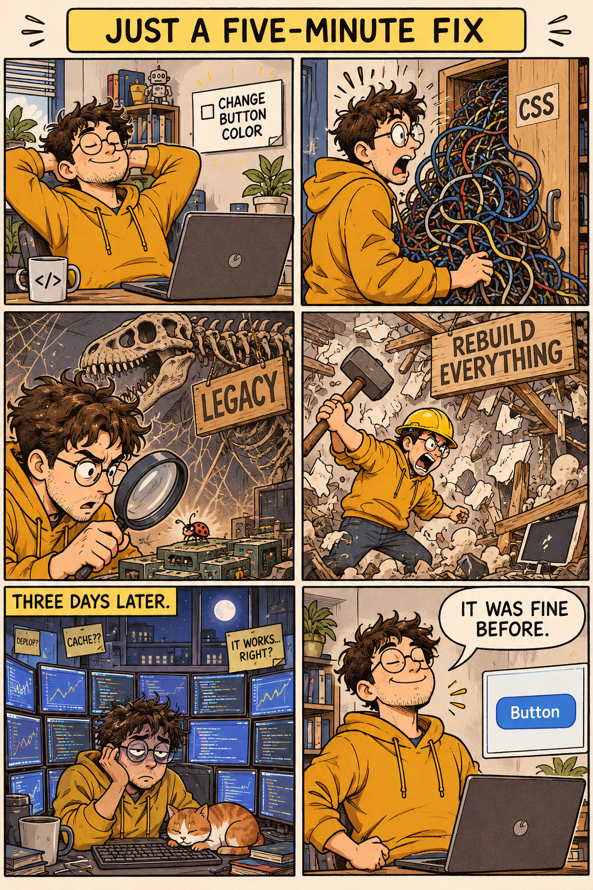

# 🎌 Anime & Manga

Range: No. 1–12, 168 · Count: 13

Load this file only when the request matches this category. For cross-cutting writing rules, pair it with `craft.md`.

### No. 1 · MAPPA-style anime action still (Jujutsu-Kaisen aesthetic)

- Image: `docs/anime-manga/anime-jjk-action.png`

  
- Metadata: Anime & Manga · `landscape` · `1536x1024` · Curated

```text
An anime action still in the visual style of MAPPA's Jujutsu Kaisen (2020 TV anime). Landscape 16:9.

A silver-white-haired young man in a dark navy school-uniform jacket, a blue blindfold across his eyes, in a mid-fight stance — one palm extended outward releasing a swirling dense-blue energy sphere with lightning-like crackles around its edge. Opposite him, a demonic shadow creature made of liquid black mass with multiple eyes lunges from the right.

Backdrop: ruined urban street at dusk, shattered asphalt, cracked neon kanji sign "呪術" in split red LED, destroyed vehicles, rubble suspended mid-air by the shockwave, rain particles caught mid-flight.

Art direction: MAPPA-style digital 2D animation — heavy cel shading, crisp line-art, rim-light on both figures, motion-blur streaks around the energy sphere. Palette of deep navy, electric cyan, crimson splashes. Kinetic-impact composition in the tradition of JJK's Shibuya arc.
```

### No. 2 · Shōnen battle key-visual (Naruto-Shippuden aesthetic)

- Image: `docs/anime-manga/anime-naruto-clash.png`

  
- Metadata: Anime & Manga · `landscape` · `1536x1024` · Curated

```text
A shōnen anime battle key-visual in the visual style of Studio Pierrot's Naruto Shippuden. Landscape 16:9.

Two ninja figures clash mid-air at the exact instant their signature jutsu collide — a glowing blue spiral of swirling chakra on the left fighter's right palm, a crackling white lightning blade on the right fighter's right palm. The collision point sends a circular shockwave outward.

Both fighters wear hitai-ate forehead protectors, jounin-style tactical vests with scroll pouches, ninja sandals. Left: spiky blond hair, whisker cheek marks, focused snarl, blue eyes. Right: dark hair, one red sharingan-like eye with three tomoe, calm expression.

Backdrop: nighttime valley, cracked earth, giant uprooted trees mid-crash, moonlit clouds parting, sakura petals caught in the shockwave.

Art direction: Studio Pierrot Naruto-Shippuden aesthetic — dynamic perspective, strong speed lines radiating from the collision, anime-action key-frame quality, digital 2D cel shading, saturated but not neon, visible genga-quality line-art, dramatic backlight.
```

### No. 3 · Shōnen manga two-page spread (basketball slam dunk)

- Image: `docs/anime-manga/manga-spread.png`

  
- Metadata: Anime & Manga · `landscape` · `1536x1024` · Curated

```text
A black-and-white shōnen manga two-page spread (landscape 16:9 as a single composition, with a faint centre-gutter line). High-contrast ink plus screentone, Weekly Shōnen Jump basketball-manga tradition (Inoue's Slam Dunk / Fujimaki's Kuroko no Basuke).

Composition: 5 irregular panels plus one large diagonal panel spanning both pages at bottom-right for the climactic slam dunk.

- Top-left: close-up of the protagonist's intense eyes, sweat beading, headband tied tight
- Top-centre: wide shot of a packed high-school gymnasium, scoreboard reading "42 — 40 · 4Q 0:03"
- Top-right: rival team captain's shocked face, mouth agape
- Centre-left: protagonist leaping skyward with both hands gripping a basketball
- Centre-right-small: sound-effect katakana "バッ" in thick black letters
- Large diagonal bottom-right (half of both pages): protagonist slamming the ball through the hoop, rim bending, massive ink-brushed kanji "決" (decide) filling the negative space

Art direction: professional mangaka quality — confident inking, dramatic screentone gradients, speed lines radiating from the dunk, varied line-weights, off-white paper texture with faint page-edge shading.

Dialogue balloons intentionally blank; only the two sound effects are visible.
```

### No. 4 · Manga relationship map — *A Tale of Two Cities*

- Image: `docs/anime-manga/manga-relationship.png`

  
- Metadata: Anime & Manga · `portrait` · `1024x1536` · Author: @cht0001 · Source: [X](https://x.com/cht0001)

```text
A manga-style illustration showing the person-relationship map for "A Tale of Two Cities" by Charles Dickens. Single full-frame composition, monochrome ink + screentone, classic shōjo / historical-manga aesthetic.

Characters as small portrait panels connected by labeled relationship lines:
- Charles Darnay ↔ Lucie Manette: "marriage"
- Sydney Carton → Lucie: "unrequited love → ultimate sacrifice"
- Lucie ↔ Dr. Manette: "father / daughter"
- Madame Defarge → Darnay family: "vengeance"
- Monsieur & Madame Defarge: "husband / wife, revolutionaries"
- Jarvis Lorry → Manette family: "loyal banker & guardian"
- Miss Pross → Lucie: "devoted protector"

Title "A TALE OF TWO CITIES" in elegant serif at top. Decorative border echoes 18th-century Paris (guillotine silhouette) / London (Tower of London). Monochrome black-ink linework with grey screentone shading.
```

### No. 5 · 16-panel anime expression grid

- Image: `docs/anime-manga/anime-expression-grid.png`

  
- Metadata: Anime & Manga · `square` · `1024x1024` · Author: Unknown · Source: [source article](https://mp.weixin.qq.com/s/ASxig6mFVYxrIE8-8Fthew)

```text
Create a 16-panel expression grid of a silver-haired, blue-eyed anime girl. Her face shape, hairstyle, and clothing must remain highly consistent across all panels. The 16 expressions should include: happy, sad, angry, surprised, shy, speechless, evil grin, contemplative, curious, proud, wronged, disdainful, confused, scared, crying, and a heart expression.
```

### No. 6 · Elegant cafe anime fashion portrait

- Image: `docs/anime-manga/anime-cafe-stockings-fashion.png`

  
- Metadata: Anime & Manga · `portrait` · `1024x1536` · Curated

```text
Create a tasteful portrait-oriented anime fashion illustration of an adult woman, age 24, with a cute playful expression, looking at the camera in a cozy European cafe at golden hour. She wears a cream blouse, charcoal pleated skirt, tailored cropped jacket, sheer black stockings, loafers, and a small ribbon hair clip; she is seated sideways at a small marble table with latte art, a sketchbook, and warm window light. Composition: three-quarter fashion portrait, elegant legs visible but relaxed and non-explicit, wholesome editorial mood, no nudity, no lingerie, no school uniform, no explicit pose, adult character only. Use polished modern anime rendering, crisp line art, luminous eyes, soft cel shading, subtle fabric texture, gentle blush, background bokeh, and a refined magazine-cover color palette.
```

### No. 7 · Neon arcade anime fashion portrait

- Image: `docs/anime-manga/anime-arcade-stockings-fashion.png`

  
- Metadata: Anime & Manga · `portrait` · `1024x1536` · Curated

```text
Create a portrait-oriented anime fashion illustration of an adult woman, age 25, in a neon arcade district at night. She has a cute confident smile and looks directly at the viewer while standing beside glowing claw machines and retro game cabinets. Outfit: black turtleneck, red satin bomber jacket, high-waisted skirt, patterned dark stockings, platform shoes, small crossbody bag, star earrings. Composition: full-body fashion portrait with strong silhouette, neon reflections on wet pavement, vending machines, sticker-covered walls, colorful signage, and cinematic rim light. Keep the pose playful but non-explicit, no nudity, no lingerie, no fetish framing, adult character only. Use high-end anime key visual rendering, crisp line art, saturated magenta-cyan lighting, clean readable background details, and glossy cyber-pop atmosphere.
```

### No. 8 · Spring cafe anime ensemble

- Image: `docs/anime-manga/anime-girls-sweet-group.png`

  
- Metadata: Anime & Manga · `landscape` · `1536x1024` · Curated

```text
Create a landscape anime ensemble key visual featuring six distinct adult young women, ages 22 to 27, with cute gentle personalities, gathered together in a cozy spring campus-cafe courtyard. The composition should feel like a polished slice-of-life anime promotional poster rather than a single portrait: one central seated character holding a sketchbook, two friends leaning in with warm smiles, one shy character holding a small bouquet, one cheerful character waving, and one calm bookish character pouring tea. Give each character a clearly different hairstyle, outfit palette, accessory, and expression while keeping the whole group harmonious and wholesome. Fashion: soft cardigans, pleated skirts, berets, ribbons, loafers, light stockings, pastel jackets, modest stylish outfits. Mood: sweet, well-behaved, playful, friendly, no fanservice, no nudity, no explicit pose, adult characters only. Use modern high-end anime rendering with crisp line art, luminous eyes, soft cel shading, warm afternoon light, cherry blossoms, cafe signage, small pastries, balanced depth, clean background details, and a strong readable group silhouette.
```

### No. 9 · Ten-panel anime character grid

- Image: `docs/anime-manga/anime-ten-panel-character-grid.png`

  
- Metadata: Anime & Manga · `landscape` · `1536x1024` · Curated

```text
Create a single landscape image containing a clean 2×5 ten-panel anime character grid. Each panel shows a different adult young woman, age 22 to 26, designed as a cute gentle heroine archetype: bookish librarian, cheerful cafe barista, shy violinist, sporty tennis player, elegant student-council president, sleepy illustrator, flower-shop assistant, soft-spoken witch apprentice, city-pop singer, and cozy winter commuter. Keep all panels consistent in art direction: modern polished anime, crisp line art, soft cel shading, luminous eyes, pastel accent colors, tidy white gutters, small readable name tag at the bottom of each panel, and a balanced character-design-sheet feel. Every character should have a distinct hairstyle, outfit, prop, and expression. The overall board should feel like a collectible anime cast sheet / ten-grid poster, cute and wholesome, no nudity, no lingerie, no explicit pose, adult characters only.
```

### No. 10 · Tide Brothers 19-page manga proof sheet

- Image: `docs/anime-manga/tide-brothers-19-page-manga.png`

  
- Metadata: Anime & Manga · `tall` · `2160x3840` · Curated

```text
Create one tall manga chapter proof sheet containing 19 numbered miniature pages for an original shonen pirate manga, not based on any existing series. Title: "TIDE BROTHERS: THE STARFALL MAP". Main characters: Rune, a cheerful rubbery-armed young pirate captain with a straw-colored scarf but original costume; and Ash, his older flame-wielding brother with a red coat, freckles, and a calm smile. They are original characters, not existing IP. Show 19 small pages arranged as a readable contact sheet, each page with 1 to 3 manga panels, black-and-white ink, screentone, dynamic speed lines, expressive faces, and clear speech bubbles. Complete plot beats: 1 cover page with the brothers on a stormy deck; 2 reunion at a floating harbor; 3 discovery of a star-shaped map; 4 alien sea-beast emerges; 5 Rune jokes "Adventure found us first!"; 6 Ash replies "Then we answer together."; 7 rival sky pirates attack; 8 slapstick cooking scene; 9 quiet flashback promise; 10 double-page-style action pose compressed into one page; 11 map glows with alien constellations; 12 crew cheers; 13 villain captain steals the compass; 14 chase across rooftop sails; 15 Ash shields Rune with fire; 16 Rune launches a spring-like punch; 17 brothers laugh after victory; 18 cliffhanger: moon door opens; 19 final page text "NEXT: THE ISLAND ABOVE THE CLOUDS". Keep dialogue short, legible, and complete. Style: classic weekly shonen manga energy, original pirate adventure, wholesome brotherhood, no gore, no existing copyrighted characters.
```

### No. 11 · Roadside mirror anime fashion selfie

- Image: `docs/anime-manga/anime-roadside-mirror-fashion.png`

  
- Metadata: Anime & Manga · `portrait` · `1024x1536` · Curated

```text
Create a portrait-oriented anime fashion illustration of an adult woman, age 24, taking a playful roadside mirror selfie in the reflection of a parked scooter mirror on a quiet Tokyo side street. She looks into the mirror with a bright mischievous smile, one hand making a small peace sign near her cheek, the other holding a phone with a cute sticker case. Outfit: soft ivory knit cardigan, navy pleated skirt, sheer black stockings, loafers, small shoulder bag, ribbon hair clip, tasteful everyday street fashion. Composition: the mirror reflection is the main frame, with blurred street signs, vending machine glow, crosswalk stripes, and spring evening light around the mirror edge. Keep the pose cute, stylish, and non-explicit; no nudity, no lingerie, no fetish framing, adult character only. Use polished modern anime rendering, crisp line art, luminous eyes, soft cel shading, warm reflections, natural street-photo energy, and a charming slice-of-life mood.
```

### No. 12 · Rainy bus-stop mirror anime portrait

- Image: `docs/anime-manga/anime-rainy-bus-stop-mirror.png`

  
- Metadata: Anime & Manga · `portrait` · `1024x1536` · Curated

```text
Create a portrait anime key visual of an adult woman, age 25, posing cutely in a convex traffic safety mirror beside a rainy roadside bus stop at blue hour. The image should show both the round mirror reflection and a bit of the real street around it: wet asphalt, umbrellas, blurred bus headlights, a small timetable sign, and glowing convenience-store windows. She wears a camel duffle coat, short plaid skirt, sheer black stockings, ankle boots, knitted scarf, and a tiny charm bracelet; her expression is playful and bashful, looking at the viewer through the mirror reflection. Keep the styling tasteful and wholesome: no nudity, no lingerie, no explicit pose, no school-uniform framing, adult character only. Use high-end anime rendering, delicate rain highlights, crisp line art, luminous eyes, soft cel shading, realistic mirror distortion, and a cozy rainy-city atmosphere.
```

### No. 168 · The five-minute fix

- Image: `docs/anime-manga/five-minute-fix-26.png`
- Display derivative: `docs/assets/previews/five-minute-fix-26.webp` (full-resolution lossless WebP; PNG retained).

  <a href="../../../docs/anime-manga/five-minute-fix-26.png"></a>
- Metadata: `gpt-image-2.6-flare` · `1024x1536` · `high` · generation · `2026-11-09` · Author: u/Ohsusannamarie · Source: [original post](https://www.reddit.com/r/ChatGPT/comments/1w0jh1w/i_started_asking_chatgpt_to_create_images_using/)
- Adaptation: Adaptation of the original five-minute-task escalation prompt, using a fictional developer and a concrete button-colour task. The exact executed prompt below includes our scenario and layout choices.

**Prompt**

```text
A witty six-panel editorial comic on one portrait page, two columns by three rows. Title: JUST A FIVE-MINUTE FIX. Same fictional adult developer, age 30, round glasses, mustard hoodie in every panel. Panel 1: relaxed at a tidy laptop, a tiny task card says CHANGE BUTTON COLOR. Panel 2: opens a cupboard labelled CSS, an avalanche of tangled wires falls out. Panel 3: inspects a small bug with a magnifier, behind it towers a dinosaur labelled LEGACY. Panel 4: now wearing a hard hat, demolishes the room, sign REBUILD EVERYTHING. Panel 5: midnight, exhausted, surrounded by twelve glowing monitors and sticky notes, tiny cat asleep on keyboard, caption THREE DAYS LATER. Panel 6: proud before the same laptop, button is exactly its original blue, small speech bubble IT WAS FINE BEFORE. Clear expressive physical comedy, detailed backgrounds that escalate, crisp ink and flat spot colours on warm white paper, readable exact short text, no extra panels.
```

- Visual QA: Six panels show the escalating task and the final blue button. Main captions are readable and the character is consistent. The initial button is not visible, so unchanged colour is conveyed by the final joke rather than demonstrated; the requested twelve monitors are not all present.
- Run record: [Image 2.6 community samples](../../../docs/image-2.6-samples.md#second-round-six-community-candidates).
