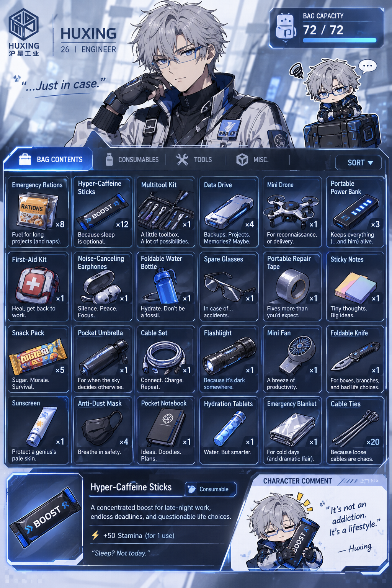
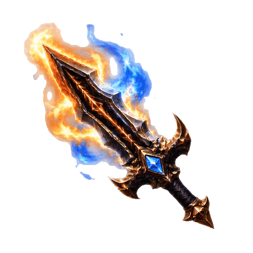

# 🎮 Gaming

Range: No. 13–22, 166, 171 · Count: 12

Load this file only when the request matches this category. For cross-cutting writing rules, pair it with `craft.md`.

### No. 13 · Hitman gameplay — OpenAI HQ

- Image: `docs/gaming/hitman-openai.png`

  
- Metadata: Gaming · `landscape` · `1536x1024` · Author: @flowersslop · Source: [X](https://x.com/flowersslop)

```text
A Hitman level where you are in the OpenAI HQ and your mission is to steal GPT-6 without getting caught
```

### No. 14 · GTA 6 gameplay — Vice City beach

- Image: `docs/gaming/gta6-beach.png`

  
- Metadata: Gaming · `landscape` · `1536x1024` · Author: @WolfRiccardo · Source: [X](https://x.com/WolfRiccardo)

```text
GTA 6 in-game footage, very detailed, very realistic. Close-up shot taken from a stationary 4k monitor. (There's a slight blurriness in the image, as it feels like it was taken handheld). A wide, bright environment. Realistic details. The character is walking on the beach with /:dog.
```

### No. 15 · Dark-fantasy swamp boss hunt

- Image: `docs/gaming/dark-fantasy-hunt.png`

  
- Metadata: Gaming · `landscape` · `1536x1024` · Curated

```text
Create an original AAA dark-fantasy action RPG screenshot. A silver-haired monster hunter in layered leather armor stands in a ruined marsh at blue hour, sword drawn toward a huge winged swamp beast rising from mist. Cinematic over-the-shoulder framing, believable HUD with health, stamina, potion icons, quest text, and minimap. Wet stones, dead trees, torchlight, moonlit fog, subtle alchemy glyphs, highly detailed materials, dramatic but readable composition, premium next-gen game look, 16:9 landscape.
```

### No. 16 · Epic fellowship bridge approach

- Image: `docs/gaming/epic-fellowship-bridge.png`

  
- Metadata: Gaming · `landscape` · `1536x1024` · Curated

```text
Create an original epic fantasy RPG key-art screenshot. A small fellowship of travelers crosses a colossal ancient stone bridge toward a luminous mountain city at sunrise. One ranger leads, a mage carries a lantern, a dwarf-like smith bears a hammer, and banners whip in the wind. Vast valley below, waterfalls, golden clouds, weathered masonry, cinematic scale, subtle HUD quest marker and compass, richly detailed armor and environment, AAA fantasy adventure tone, 16:9 landscape, highly detailed and uplifting.
```

### No. 17 · Retro Japanese town pixel RPG

- Image: `docs/gaming/retro-japan-rpg.png`

  
- Metadata: Gaming · `landscape` · `1536x1024` · Author: Unknown · Source: [Reddit](https://www.reddit.com/r/midjourney/comments/1kozn4u/retro_video_games_in_japan_prompts_included/)

```text
Create an isometric pixel-art RPG screenshot of a traditional Japanese village during cherry blossom season. Sakura petals drift through the air, a samurai player character practices sword moves in the square, villagers watch nearby, and the interface includes an inventory panel, stamina gauge, skill cooldown timers, and subtle quest UI. Cozy retro console feeling, soft ambient pastel lighting, crisp pixel details, 16:9 gameplay composition.
```

### No. 18 · Cyberpunk Europe action HUD

- Image: `docs/gaming/cyberpunk-europe-action.png`

  
- Metadata: Gaming · `landscape` · `1536x1024` · Author: Unknown · Source: [Reddit](https://www.reddit.com/r/midjourney/comments/1kzzy77/cyberpunk_video_games_in_european_cities_prompts/)

```text
Create a third-person cyberpunk action game screenshot set in a neon-soaked European capital at night. The protagonist has glowing cybernetic implants and stands on rain-slick streets near a famous landmark while holograms, drones, and flying traffic crowd the skyline. Add a polished game HUD with health bar, ammo count, radar, stealth/energy meters, and mission overlays. Vivid cyan-magenta palette, wet reflections, cinematic intensity, 16:9.
```

### No. 19 · Anime open-world adventure HUD

- Image: `docs/gaming/anime-open-world.png`

  
- Metadata: Gaming · `landscape` · `1536x1024` · Author: Unknown · Source: [Reddit](https://www.reddit.com/r/midjourney/comments/1lh2l98/anime_style_video_games_prompts_included/)

```text
Create a third-person over-the-shoulder screenshot from a nostalgic anime-style open-world adventure game. The protagonist stands in a lush forest with detailed foliage and vibrant shading, drawing a bow toward distant enemies. Add a clean on-screen HUD: quest log, compass at the top, character portrait and status effects at bottom left, subtle rain droplets on screen, and sun rays filtering through trees. Keep the composition dynamic, the forest immersive, and the UI believable like a premium action-RPG screenshot.
```

### No. 20 · Mobile MOBA arena HUD

- Image: `docs/gaming/mobile-moba-arena-hud.png`

  
- Metadata: Gaming · `landscape` · `1536x1024` · Curated

```text
Create an original landscape mobile MOBA / action-RPG gameplay screenshot, inspired by competitive lane-battle games but not copying any existing franchise. 16:9 landscape, polished mobile game HUD. Scene: a bright fantasy arena at golden-hour dusk, three stylized heroes clash near a central river bridge and glowing crystal objective. Camera: slightly elevated isometric third-person gameplay view, readable battlefield lanes, minions, spell effects, terrain brush, turret silhouettes, and a boss-objective pit in the distance. HUD design: bottom-left translucent virtual joystick, bottom-right four circular ability buttons with cooldown numbers, ultimate button glowing but 87% charged, top-center score bar reading "12 - 11", match timer "08:42", team health bars, mini-map in the top-left, item quick slots, gold counter "3,420", clean mobile-safe margins, crisp icons, no real game logos. Art direction: premium anime-fantasy 3D mobile game, saturated teal / gold / violet palette, sharp readable UI, dynamic spell VFX, high-detail materials, readable text, screen-capture feel, not a poster, not a mockup board.
```

### No. 21 · Low-poly samurai strategy village

- Image: `docs/gaming/lowpoly-samurai-strategy.png`

  
- Metadata: Gaming · `landscape` · `1536x1024` · Author: Unknown · Source: [Reddit](https://www.reddit.com/r/midjourney/comments/1l2d5dr/lowpoly_strategy_video_games_in_japan_prompts/)

```text
Create an isometric low-poly strategy game screenshot of a mountainous Japanese village with rice terraces, torii gates, samurai and archer units in formation, and a tactical RTS interface. Include unit selection boxes, resource counters for rice and wood, fog-of-war minimap, command overlays, and warm daylight with soft shadows. Stylized but readable, modern indie strategy game key art, 16:9.
```

### No. 22 · Nine-panel dark-fantasy worldbuilding set

- Image: `docs/gaming/worldbuilding-nine-panel-set.png`

  
- Metadata: Gaming · `square` · `1024x1024` · Author: @aleenaamiir · Source: [X](https://x.com/aleenaamiir/status/2046866168208916503)

```text
Create a square 3x3 worldbuilding set for an original dark-fantasy universe called "Saltwind Reach". Each panel is a distinct but consistent scene: a storm-battered coastal fortress at dawn, a foggy market street, a knight relic close-up, a handwritten map fragment, a monster silhouette study, a candlelit tavern interior, an alchemist kit flat lay, a moonlit harbor, and a faction banner concept. Keep one cohesive art direction across all nine panels: painterly realism, muted teal / rust / bone palette, cinematic weather, premium concept-art presentation, small caption labels, and strong consistency across costume motifs, architecture, symbols, and lighting. The full board should feel like a polished pre-production worldbuilding sheet rather than a collage of unrelated images.
```

### No. 166 · What is in a cyber engineer’s bag?

- Image: `docs/gaming/engineer-inventory-26.png`
- Display derivative: `docs/assets/previews/engineer-inventory-26.webp` (full-resolution lossless WebP; PNG retained).

  <a href="../../../docs/gaming/engineer-inventory-26.png"></a>
- Input: [No. 31 character sheet](gallery-character-design.md), `docs/character-design/character-sheet.png`; reference prompt credited to @MANISH1027512.
- Metadata: `gpt-image-2.6-flare` · `1024x1536` · `high` · reference edit · `2026-11-09` · Author: @chachaai_jp · Source: [original post](https://x.com/chachaai_jp/status/2049066868502405257)
- Adaptation: Character belongings shown as a mobile-game inventory; original author labels it GPT Image 2. The exact executed prompt below includes our scenario and layout choices.

**Prompt**

```text
Use the fictional adult 26-year-old character in the reference sheet. このキャラのカバンの中身を紹介する画像を作成して。キャラの性格が伝わる構成、モダンなソシャゲのインベントリ画面のようなデザイン。 Keep this tasteful and non-explicit. Use English for item labels. Show a densely packed inventory with visually distinct items and short humorous descriptions. Portrait 2:3.
```

- Visual QA: The output has 24 illustrated inventory cells, short item descriptions and character reactions. The source character cues recur, but HUXING (the company name in the reference) is used like the character name. This is a fictional UI illustration, not a working inventory or a verified item-count system.
- Run record: [Image 2.6 community samples](../../../docs/image-2.6-samples.md#second-round-six-community-candidates).

### No. 171 · Fire cursor: sprite sheet to local GIF

- Images: `docs/gaming/sword-cursor-sheet.png` (generated sheet), `docs/gaming/sword-cursor.gif` (local assembly).

  <a href="../../../docs/gaming/sword-cursor-sheet.png"></a>
- Metadata: `gpt-image-2.6-flare` · `2048x1024` sheet · `high` · `2026-11-09` · Author: @hAru_mAki_ch · Source: [X cursor workflow](https://x.com/hAru_mAki_ch/status/2119072107196035314) and [author tutorial](https://note.com/sunwood_ai_labs/n/na0dbbfa3811f).
- Adaptation: our fire-and-ice sword brief follows the author's image-to-cursor workflow. It is not the author's exact prompt.
- Local output: eight `512x512` frames, `160 ms` each, `1.28 s`, infinite GIF loop. The HTML player also plays the original PNG cells without GIF palette reduction.

**Prompt**

```text
An animation sprite sheet for a fantasy desktop cursor, inspired by a flaming-sword mouse pointer. Exactly 8 frames in a 4-column by 2-row uniform grid, read left to right then top to bottom. Canvas 2048 by 1024, each cell exactly 512 by 512. Transparent background, no gutters, no borders, no text, no labels. In every cell the same small ornate obsidian sword points diagonally toward the upper-left. Its sharp tip is fixed at cell coordinate (100,100), blade geometry and position identical in every frame. Bright amber and electric-blue flame curls around the blade, progressing smoothly through eight phases and returning to the initial shape at the loop boundary. The blade stays still; only flames, a few sparks and reflected light move. Keep all effects within the middle 360 by 360 pixels of each cell. Crisp illustrated game-UI asset, luminous edges, convincing metallic highlights, strong silhouette, no character, no duplicate swords within a cell. Do not draw checkerboards; use actual transparency.
```

```bash
gpt-image --model gpt-image-2.6-flare -p "<PROMPT ABOVE>" --size 2048x1024 --quality high --background transparent --format png --moderation auto -f sheet.png
gpt-image animate --sheet sheet.png --columns 4 --rows 2 --duration 160 -f cursor.gif --preview player.html --title "Emberglass cursor"
```

- Visual QA: actual alpha is present; eight distinct cells show changing flames and highlights. The sword tip shifts slightly between frames. This is an animation asset study, not a pixel-registered OS cursor or an installed `.cur`/`.ani` package.
- [Interactive frame player](../../../docs/demos/sword-player.html) · [Workflow and checks](../../../docs/creative-workflows.md).
