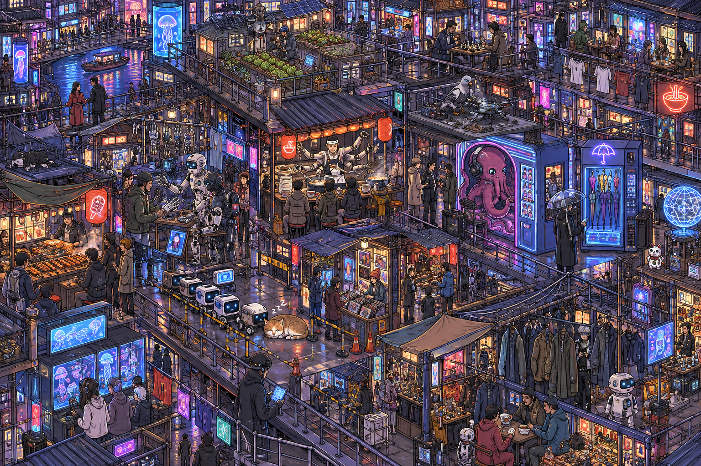

# 🎨 Illustration

Range: No. 46–47, 170 · Count: 3

Load this file only when the request matches this category. For cross-cutting writing rules, pair it with `craft.md`.

### No. 46 · Vintage Amalfi Coast travel poster

- Image: `docs/illustration/amalfi-poster.png`

  
- Metadata: Illustration · `portrait` · `1024x1536` · Author: @WolfRiccardo · Source: [X](https://x.com/WolfRiccardo)

```text
Modern pencil illustration of Vintage travel poster illustration of the Amalfi Coast, Italy, panoramic coastal cliff road scene, classic 1960s white car driving along a curved seaside road, deep blue Mediterranean sea with small sailboats, colorful pastel hillside village, bright blue sky with soft clouds, lemon tree branches with vibrant yellow lemons framing the foreground, warm summer sunlight, bold vibrant colors, retro 1950s travel poster style, cinematic composition, high detail, screen print texture, graphic illustration. Hand-drawn style, illustration with loose strokes and defined contours. High-contrast color palette, maintaining chromatic harmony between background and elements. Contemporary and decorative aesthetic.
```

### No. 47 · Paper-cut forest night market

- Image: `docs/illustration/papercut-forest-market.png`

  
- Metadata: Illustration · `landscape` · `1536x1024` · Curated

```text
Create a landscape editorial illustration in layered paper-cut style: a tiny forest night market hidden beneath giant mushrooms and fern leaves. Include warm lantern stalls selling acorn cakes, beetle taxis, a fox calligrapher, a badger tea vendor, children holding leaf umbrellas, and fireflies forming soft dotted paths. Style anchor: mid-century children’s book illustration meets contemporary layered paper diorama, visible cut-paper edges, soft shadows between layers, muted moss green, pumpkin orange, cream, and ink-blue palette. First glance: a cozy glowing market silhouette. Second glance: many small vendor stories. Third glance: handmade paper texture, tiny signage, and playful animal gestures. No photorealism, no 3D plastic look, no cluttered unreadable faces.
```

### No. 170 · Find Ling Yuan in the night market

- Image: `docs/illustration/find-engineer-night-market-26.png`
- Display derivative: `docs/assets/previews/find-engineer-night-market-26.webp` (full-resolution lossless WebP; PNG retained).

  <a href="../../../docs/illustration/find-engineer-night-market-26.png"></a>
- Input: [No. 31 character sheet](gallery-character-design.md), `docs/character-design/character-sheet.png`; reference prompt credited to @MANISH1027512.
- Metadata: `gpt-image-2.6-flare` · `1536x1024` · `high` · reference edit · `2026-11-09` · Author: u/Ohsusannamarie · Source: [original post](https://www.reddit.com/r/ChatGPT/comments/1w0jh1w/i_started_asking_chatgpt_to_create_images_using/)
- Adaptation: Adaptation of the original seek-and-find prompt, replacing private personal history with a fictional cyberpunk market and a supplied character. The exact executed prompt below includes our scenario and layout choices.

**Prompt**

```text
Create a densely populated hand-drawn seek-and-find picture of a multilevel cyberpunk night market. Hide exactly one small instance of the adult 26-year-old engineer in the reference: silver hair, blue glasses, white-and-navy jacket, black utility trousers. Place him in the lower-right quarter, partially obscured by hanging coats, still identifiable on close inspection. Do not duplicate him or place a portrait key on the image. Fill the scene with hundreds of tiny narrative details: robots bargaining over spare fingers, a noodle chef using six arms, a pigeon repairing a drone, an octopus operating a photo booth, a vending machine selling umbrellas inside umbrellas, a queue of delivery robots blocked by a sleeping cat, a balcony chess match, a tiny rooftop vegetable farm, glowing food stalls, laundry, cables, stairs and little bridges. All other humans are adults. Every group is doing something different. Crisp thin ink outlines, saturated flat colours, high-angle cutaway perspective, edge-to-edge landscape picture, no dominant hero, no large blank space, no title or labels.
```

- Visual QA: The night market contains the six-armed chef, robot queue stopped by a sleeping cat, rooftop plants, chess players, pigeon repair scene and octopus booth. A sufficiently recognisable single instance of the supplied character could not be confirmed. Keep reference-only; do not present it as a solved seek-and-find puzzle.
- Run record: [Image 2.6 community samples](../../../docs/image-2.6-samples.md#second-round-six-community-candidates).
