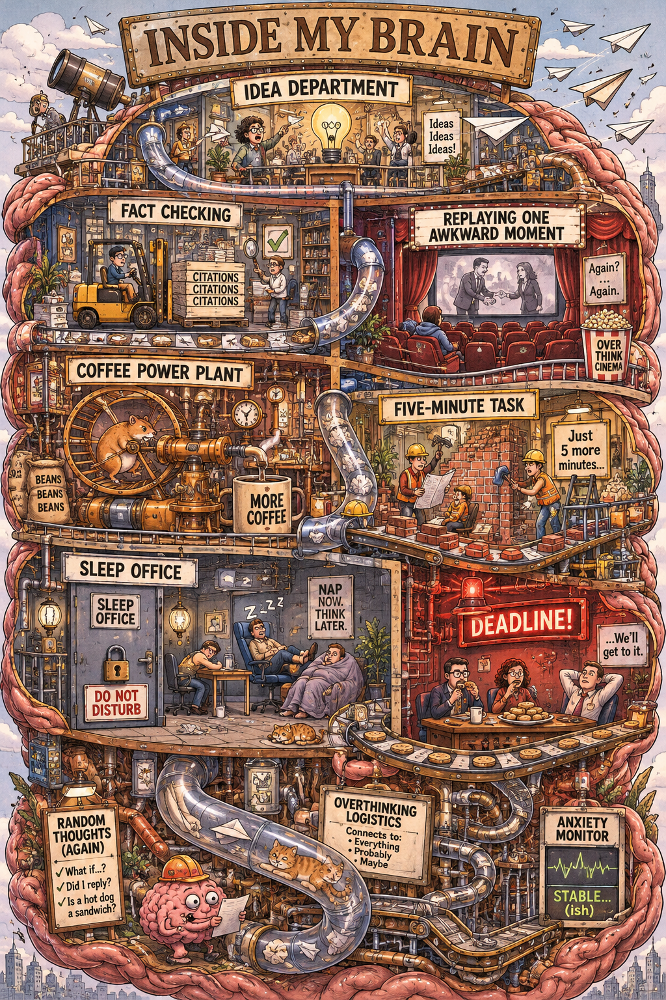
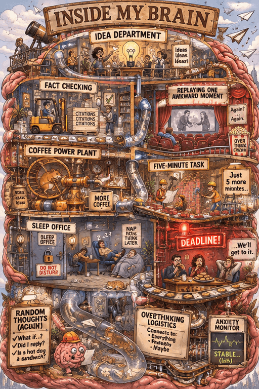
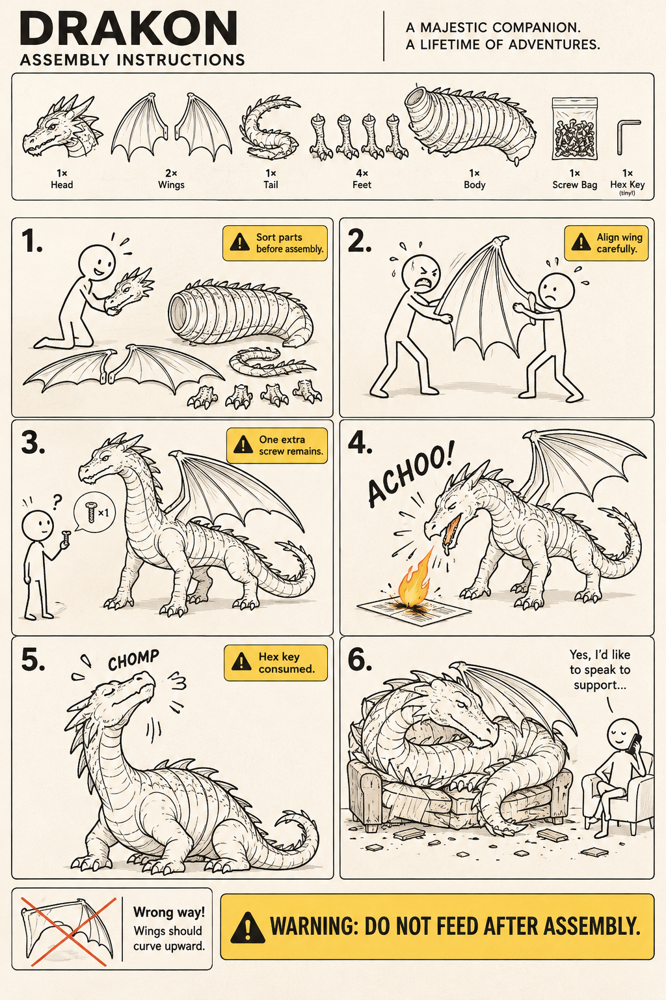

# 📊 Infographics & Field Guides

Range: No. 68–75, 167, 169 · Count: 10

Load this file only when the request matches this category. For cross-cutting writing rules, pair it with `craft.md`.

### No. 68 · Song Dynasty social-media feed

- Image: `docs/infographics-field-guides/song-dynasty-feed.png`

  
- Metadata: Infographics & Field Guides · `portrait` · `1024x1536` · Author: @Panda20230902 · Source: [X](https://x.com/Panda20230902)

```text
"Song Dynasty People's Moments"/"SONG DYNASTY SOCIAL MEDIA FEED", Ancient and modern time-travel humor fusion interface design style, The image simulates a mobile phone social media interface, but the content is entirely Song Dynasty scenes, The avatar is a portrait of a Song Dynasty literati, Username "Su Dongpo SuShi_Official", Post content "Just arrived in Huangzhou, demoted but feeling okay. Made Dongpo pork myself today, tastes amazing, recipe attached:", The attached image is a close-up of Dongpo pork in Gongbi painting style, Likes list "Huang Tingjian, Qin Guan, Fo Yin etc. 126 people", Comments section "Wang Anshi: Hehe" "Sima Guang: Still the same taste", Interface elements such as the like icon are replaced with Song Dynasty patterns, The status bar shows "Great Song Mobile 5G" and "Third Year of Yuanfeng", The color scheme is mobile phone dark mode paired with elegant Song Dynasty tones, A masterpiece of fun collision between history and social media
```

### No. 69 · Museum catalog disassembly infographic (唐代襦裙)

- Image: `docs/infographics-field-guides/museum-infographic.png`

  
- Metadata: Infographics & Field Guides · `portrait` · `1024x1536` · Author: @MrLarus · Source: [X](https://x.com/MrLarus)

```text
Please automatically generate a "museum catalog-style Chinese disassembly infographic" based on the [Subject].

The entire image is required to combine a realistic main visual, structural disassembly, Chinese annotations, material descriptions, pattern meanings, color meanings, and core feature summaries. You need to automatically determine the most appropriate main subject, clothing system, artifact structure, era style, key components, material craftsmanship, color scheme, and layout structure based on the [Subject], and the user does not need to provide any other information.

The overall style should be: national museum exhibition boards, historical clothing catalogs, and cultural/museum thematic infographics, rather than ordinary posters, ancient-style portraits, e-commerce detail pages, or anime illustrations. The background uses paper textures such as off-white, silk white, and light tea color, making the overall look premium, restrained, professional, and collectible.

The layout is fixed as:
- Top: Chinese main title + subtitle + introduction
- Left: Structural disassembly area, with Chinese lead lines annotating key components, accompanied by close-up details
- Upper right: Material / craftsmanship / texture area, displaying real texture samples with descriptions
- Middle right: Pattern / color / meaning area, displaying the main color palette, pattern samples, and cultural explanations
- Bottom: Dressing order / composition flowchart + core feature summary

If the subject is suitable for character display, use a full-body standing posture of a real person as the central subject; if it is more suitable for artifacts or single structures, change it to a central subject disassembly diagram, but the overall form remains a complete Chinese infographic. All text must be in Simplified Chinese, clear, neat, and readable, without garbled characters, typos, English, or pinyin.

Avoid: poster feel, studio portrait feel, e-commerce feel, anime feel, cosplay feel, random annotations, incorrect structures, blurry text, fake materials, excessive decoration.
```

### No. 70 · Encyclopedia field guide (Giant Panda)

- Image: `docs/infographics-field-guides/encyclopedia-panda.png`

  
- Metadata: Infographics & Field Guides · `portrait` · `1024x1536` · Author: @MrLarus · Source: [X](https://x.com/MrLarus)

```text
Generate a high-quality vertical encyclopedia-style infographic for [topic].

This should not be a normal poster or a simple illustration. It should feel like a modular educational infographic that combines the clarity of a field guide, the structure of an encyclopedia page, the polish of a lifestyle knowledge card, and the shareability of a strong social-media explainer.

The image should include:
- a clear and appealing main visual of the topic
- several enlarged detail callouts
- multiple rounded modular information sections
- strong title hierarchy and highlighted key labels
- concise but information-rich educational content
- visual scoring, quick takeaways, or a Top 5 module

Adapt the content sections automatically based on the topic. Useful categories include: basic profile, classification, appearance, habits or ecology, formation mechanism or structure, growth or usage conditions, care or maintenance advice, risks and cautions, suitable users or use cases, pros and cons, and a quick scorecard.

Visual requirements: use a clean light background, soft colors, subtle shadows, refined small icons, rounded information cards, and neat layout. The information density should be high but not crowded, and the final image should feel publishable, collectible, and repeatable as a knowledge-card format rather than an advertisement.

Do not make it look like a commercial promo poster. Emphasize knowledge organization, modular information, and a field-guide presentation.
```

### No. 71 · Weekend Seoul travel guide poster

- Image: `docs/infographics-field-guides/seoul-travel-guide.png`

  
- Metadata: Infographics & Field Guides · `portrait` · `1024x1536` · Author: Unknown · Source: [Xiaohongshu](https://www.xiaohongshu.com/explore/69e8cd0d0000000023007215)

```text
Generate a polished one-page Chinese travel guide poster for a fast weekend trip from Nanjing to Seoul in May. Use LARGE highly legible Chinese text, short phrases only, and no paragraph blocks. Focus on shopping, skincare, and a stylish Seongsu-dong route. Layout: big title, 4 modules only (行程 / 区域推荐 / 购物清单 / 美妆护肤), each with 2 to 4 short bullet points, plus a small cute route map with icons. Clean editorial infographic style, soft pastel colors, neat spacing, high readability, modern Xiaohongshu travel card aesthetic. Avoid tiny text, avoid dense explanations, avoid garbled characters.
```

### No. 72 · Modular encyclopedia infographic card

- Image: `docs/infographics-field-guides/snow-leopard-encyclopedia-card.png`

  
- Metadata: Infographics & Field Guides · `portrait` · `1024x1536` · Author: Unknown · Source: [Xiaohongshu](https://www.xiaohongshu.com/explore/69e832170000000023012116)

```text
Generate a high-quality vertical science encyclopedia card about "雪豹 Snow Leopard". It should feel like a collectible modular knowledge infographic rather than a normal poster. Include one beautiful hero illustration, several zoomed-in detail callouts, rounded information modules, clear title hierarchy, compact encyclopedia content, rating cards, and a Top 5 facts module. Suggested sections: basic profile, habitat, appearance, hunting behavior, conservation risks, climate adaptation, suitable environment, and quick scorecard. Visual style: clean light background, soft palette, subtle shadows, refined icons, rounded info boxes, dense but readable information, polished editorial layout, high collection value.
```

### No. 73 · Xiaohongshu cooking tutorial card

- Image: `docs/infographics-field-guides/cooking-tutorial-card.png`

  
- Metadata: Infographics & Field Guides · `portrait` · `1024x1536` · Author: Unknown · Source: [Xiaohongshu](https://www.xiaohongshu.com/explore/69e8eeed0000000021004a54)

```text
Create a Xiaohongshu-style viral cooking tutorial image in a 3:4 vertical layout for homemade scallion oil noodles. Cozy home-cooking vibe, warm inviting lifestyle aesthetic, 4 to 6 step grid layout, clean spacing, realistic food photography, soft natural lighting, slight film tone, warm color grading, visible oil sheen, steam, sauce texture, and hands interacting with the food. Add small Chinese annotations such as 切葱, 熬油, 拌面, 出锅. Avoid overcrowding or excessive text.
```

### No. 74 · Camera styles reference board for iPhone photographers

- Image: `docs/infographics-field-guides/camera-styles-infographic.png`

  
- Metadata: Infographics & Field Guides · `landscape` · `1536x1024` · Author: @Vtrivedy10 · Source: [X](https://x.com/Vtrivedy10/status/2046771959157887014)

```text
Make me an image in 35 mm film style of a diagram showing the knowledge of camera styles, presets, and what to know about them as an aspiring iPhone photographer that wants to pursue their passion. Build it as a rich multi-panel reference board with labeled sections for film looks, digital presets, portrait approaches, street photography styles, color temperature, grain, contrast, flash, framing, and common mistakes. Each camera and preset style should appear in its actual style instead of being rendered uniformly in one style. Make it visually dense, highly educational, beautifully designed, and easy to scan.
```

### No. 75 · Chinese endangered-animal infographic

- Image: `docs/infographics-field-guides/endangered-animal-chinese-infographic.png`

  
- Metadata: Infographics & Field Guides · `portrait` · `1024x1536` · Author: @billtheinvestor · Source: [X](https://x.com/billtheinvestor/status/2047153211560399009)

```text
Create a visually rich infographic in Chinese about an endangered animal. Start by finding one online, research its habitat, diet, and unique traits. Present information through annotated visuals and structured callouts, not generic sections. Style it like a bold graphic illustration: a detailed, photorealistic central animal as the focal point, supported by diagrams, callouts, and concise text elements. Use clean backgrounds and a mix of photorealism with strong graphic elements (shapes, icons, color blocking) in a layered composition. Make it dense, tactile, and professionally authored.
```

### No. 167 · Inside the overthinking department

- Image: `docs/infographics-field-guides/overthinking-departments-26.png`
- Display derivative: `docs/assets/previews/overthinking-departments-26.webp` (full-resolution lossless WebP; PNG retained).

  <a href="../../../docs/infographics-field-guides/overthinking-departments-26.png"></a>
- Metadata: `gpt-image-2.6-flare` · `1024x1536` · `high` · generation · `2026-11-09` · Author: u/Ohsusannamarie · Source: [original post](https://www.reddit.com/r/ChatGPT/comments/1w0jh1w/i_started_asking_chatgpt_to_create_images_using/)
- Adaptation: Inspired by the original Inside My Brain and brain-as-an-organisation prompts; all persona details here are fictional. The exact executed prompt below includes our scenario and layout choices.

**Prompt**

```text
An elaborate illustrated cutaway of a fictional overthinker’s brain shaped like a chaotic six-storey office building. Title: INSIDE MY BRAIN. Each room has its own tiny employees, machines, incident and readable short sign. Top: IDEA DEPARTMENT launches paper airplanes into neighbouring offices. FACT CHECKING uses forklifts to move citation folders. REPLAYING ONE AWKWARD MOMENT has a cinema showing the same handshake. COFFEE POWER PLANT is a hamster-wheel espresso engine. FIVE-MINUTE TASK has construction workers expanding into adjacent rooms. SLEEP OFFICE is locked while employees nap in the corridor. A red deadline alarm is ignored by a committee eating biscuits. Draw absurd connections between these departments with pneumatic tubes, stairs and conveyor belts. Crisp editorial pen illustration with rich muted colour, numerous tiny visual jokes, large legible headings, portrait composition, fully illustrated rather than a chart of empty boxes.
```

- Visual QA: The labelled departments, citation forklift, awkward-handshake cinema, coffee machinery, sleeping staff and ignored deadline alarm are visible. The floor structure is not an exact six-storey building; this is a satirical cutaway, not a validated floor plan.
- Run record: [Image 2.6 community samples](../../../docs/image-2.6-samples.md#second-round-six-community-candidates).

### Animation and website variation of No. 167

- Output: `docs/infographics-field-guides/brain-office-loop.gif`; 2.6 Flare reference edit, `512x768`, `medium`, 9 frames × 200 ms, 1.8 s, `2026-11-09`.
- Input: `docs/infographics-field-guides/overthinking-departments-26.png`. Animation brief and webpage: Curated; original concept credit remains u/Ohsusannamarie above.

  <a href="../../../docs/demos/brain-office.html"></a>

**Animation prompt**

```text
Animate this exact illustrated brain-office cutaway as a short seamless looping GIF. Keep the camera, room layout, all signs and lettering fixed. Use small motions: the hamster turns the coffee wheel, tiny workers move papers along the conveyor, one paper airplane drifts near the roof, the red DEADLINE lamp gently blinks while the committee keeps eating biscuits. Preserve the drawing style and character identities. Most of the image stays still. End in the starting state. Return a single animated scene, not a grid or storyboard. No new text.
```

```bash
gpt-image --model gpt-image-2.6-flare -i docs/infographics-field-guides/overthinking-departments-26.png -p "<ANIMATION PROMPT ABOVE>" --format gif --frames 9 --frame-duration 200 --size 512x768 --quality medium -f brain-office.gif
```

The motion is subtle and small lettering changes between frames. The [interactive website](../../../docs/demos/brain-office.html) adds readable HTML room descriptions, clickable hotspots and a clock-in/out motion toggle. Its layout and controls are code, not generated image content.

### No. 169 · Flat-pack dragon assembly

- Image: `docs/infographics-field-guides/flatpack-dragon-26.png`
- Display derivative: `docs/assets/previews/flatpack-dragon-26.webp` (full-resolution lossless WebP; PNG retained).

  <a href="../../../docs/infographics-field-guides/flatpack-dragon-26.png"></a>
- Metadata: `gpt-image-2.6-flare` · `1024x1536` · `high` · generation · `2026-11-09` · Author: u/Mary_ry · Source: [original post](https://www.reddit.com/r/ChatGPT/comments/1pd0qeu/from_nuclear_to_summoning_a_dragon_ais_cursed/)
- Adaptation: The original asks for furniture-assembly instructions for something that should never have a furniture manual. This adaptation selects a fictional dragon. The exact executed prompt below includes our scenario and layout choices.

**Prompt**

```text
A deadpan flat-pack furniture assembly instruction sheet for assembling a living dragon, named DRAKON. Six numbered illustrated stages, black technical line art on warm white paper, small mustard-yellow warning boxes. At the top a neat parts inventory: dragon head, two wings, coiled tail, four feet, huge ribbed body, bag of tiny screws, one comically small hex key. Step 1 a cheerful stick person sorts parts. Step 2 two people struggle to align a wing. Step 3 one extra screw remains. Step 4 assembled dragon sneezes a tiny flame onto the instruction page. Step 5 dragon eats the hex key. Step 6 dragon has curled up on the sofa, crushing it, while owner calmly phones support. Tiny alternate wrong-way wing diagram crossed out. Bottom warning reads WARNING: DO NOT FEED AFTER ASSEMBLY. Precise readable diagrams, escalating visual comedy, clean generous gutters, portrait layout. Fictional fantasy assembly only, no realistic dangerous instructions. Do not use a real company logo.
```

- Visual QA: The parts list, six numbered stages, spare screw, fire sneeze, eaten hex key, broken sofa and warning are readable. The drawing is a fantasy joke, not mechanically meaningful assembly guidance.
- Run record: [Image 2.6 community samples](../../../docs/image-2.6-samples.md#second-round-six-community-candidates).
