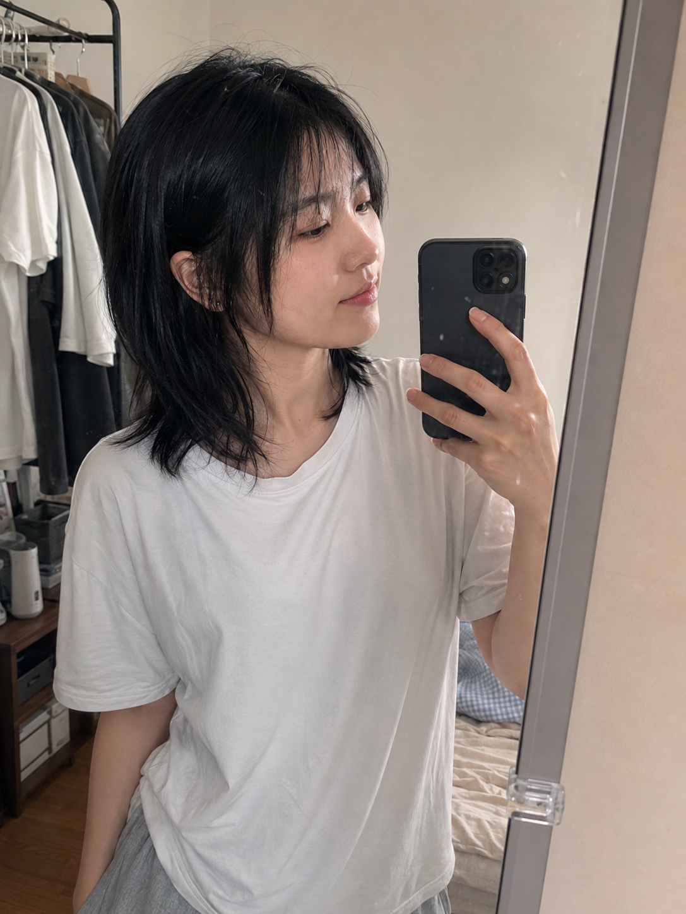
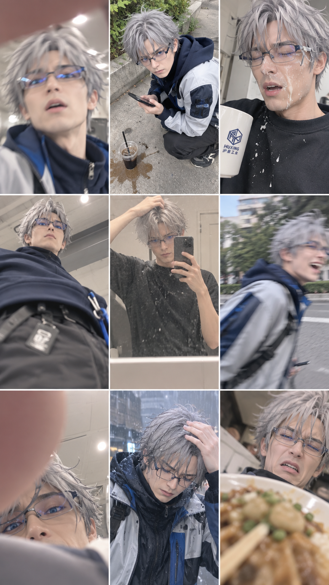

# 📷 Photography

Range: No. 63–67, 164 · Count: 6

Load this file only when the request matches this category. For cross-cutting writing rules, pair it with `craft.md`.

### No. 63 · RAW iPhone — 42nd Street subway

- Image: `docs/photography/photoreal-subway.png`

  
- Metadata: Photography · `landscape` · `1536x1024` · Author: @WolfRiccardo · Source: [X](https://x.com/WolfRiccardo)

```text
Create a completely RAW quality, unprocessed, unedited image with full iPhone camera quality. A subway station in USA, a momentary blur. The subway is in motion. In front of the subway, there is an elderly woman and man.
```

### No. 64 · Handwritten notebook flatlay

- Image: `docs/photography/handwritten-notebook.png`

  
- Metadata: Photography · `landscape` · `1536x1024` · Author: @patrickassale · Source: [X](https://x.com/patrickassale)

```text
Amateur photo of an open notebook lying flat, filled with handwritten notes in black ballpoint pen. The handwriting is casual and slightly messy, like personal notes, natural imperfections, crossed out words, underlined headings. Shot from slightly above, natural daylight from a window, no flash. Casual desk setting, shot on iPhone
```

### No. 65 · Chess board mid-tournament game

- Image: `docs/photography/chess-midgame.png`

  
- Metadata: Photography · `landscape` · `1536x1024` · Author: @EddGorenstein · Source: [X](https://x.com/EddGorenstein)

```text
Generate a photorealistic photo of a chess board during the middle of a serious tournament game. Top-down three-quarter view, shallow depth of field. All pieces clearly distinguishable and correctly shaped: pawns, rooks, knights (with horse-head silhouette), bishops (mitre tops), queens, kings (with cross finials). The position is mid-game: several pieces already captured and set aside to the right of the board, some pawns advanced, pieces clustered around the central files d4-e5-f4.

Materials: polished wooden staunton-style pieces — dark side in rosewood, light side in maple. Board made of inlaid maple and walnut squares. A digital chess clock sits to the left showing "00:14:28 / 00:08:47". Soft overhead tournament lighting, blurred tournament-hall background. All pieces accurate, no mutants, no extra sets.
```

### No. 66 · 360° equirectangular jungle panorama

- Image: `docs/photography/panorama-jungle.png`

  
- Metadata: Photography · `wide` · `2048x1152` · Author: @AIimagined · Source: [X](https://x.com/AIimagined)

```text
360 equirectangular panorama of a dense prehistoric jungle scene. Cinematic detail. Strict 2:1 aspect ratio (e.g. 4096×2048). No distortion at the seams — the left and right edges must wrap seamlessly.

Scene: towering fern-covered trees, shafts of golden sunlight piercing the canopy, a slow river winding through the centre foreground, mist rising off the water. Scattered dinosaurs of varied species — a grazing Brachiosaurus neck visible among distant tree canopy, two small Gallimimus drinking at the river's edge, a Triceratops in the background underbrush. Tropical birds in flight, butterflies, dragonflies over the water.

Lighting: late-afternoon golden hour, warm directional backlight through the canopy. High dynamic range, slight atmospheric haze. Equirectangular projection suitable for spherical / 360 viewers.
```

### No. 67 · Natural SNS portrait

- Image: `docs/photography/natural-sns-portrait.png`

  
- Metadata: Photography · `portrait` · `1087x1447` · Author: @LunarXuan · Source: [GitHub](https://github.com/LunarXuan/natural-sns-portrait)

English realism guidelines from the source skill, paired with a contributor-selected mirror-selfie example. Use these guidelines alongside a scene, outfit, pose, and framing request; they are not the complete generation prompt for this image.

```text
# Realism Guidelines

Apply these as the default aesthetic target.

## Basic mindset

- Make the result feel like a natural photo of a clearly adult woman in her 20s that could plausibly appear on a real SNS feed.
- Suppress CG-like texture, aggressive beauty filtering, plastic skin, and unnatural shine.
- Preserve attractiveness without making the face or skin impossibly perfect.
- Avoid fashion-campaign or advertisement styling; favor ordinary daily-life photography.
- Prioritize real-world presence, lived-in detail, and natural imperfection over perfection.

## Photography and texture

- Prefer an everyday smartphone snapshot rather than a high-end camera look.
- Use natural window light or existing practical lighting in the scene.
- Allow mild hand-shake softness, smartphone sensor noise, modest sharpening artifacts, and slightly rough resolution.
- Keep framing a little imperfect: slight tilt, uneven negative space, minor cropping, or off-center composition.
- Avoid poses that look designed for a photoshoot; favor a caught-in-the-moment feeling.
- Do not overuse cinematic depth of field. Ordinary phones often keep more of the scene legible.

## Facial details

- Keep realistic facial proportions and bone structure.
- Do not enlarge the eyes. Preserve natural sclera ratio, eyelid thickness, and subtle left-right differences.
- Keep expressions restrained and spontaneous; a faint smile or relaxed neutral expression is preferable to a forced grin.
- Unless explicitly requested, avoid rigid straight-on passport framing.
- Preserve mild facial asymmetry around brows, eyes, cheeks, and mouth.

## Final touches

- Keep pores, fine facial hair, soft redness, tiny blemishes, and natural shadow variation where appropriate.
- Hands and fingers must have plausible count, joints, lengths, overlap, and grip.
- Keep the overall impression clean, approachable, and cute while remaining physically believable.
- Hair should contain flyaways, irregular clumps, slight frizz, and uneven strands rather than perfectly separated hair fibers.
- Use realistic body proportions consistent with the reference or request. Avoid exaggerated hourglass shaping or model-like body retouching.
- Favor the kind of cuteness that feels possible in real life rather than doll-like perfection.

## Common negative constraints

Avoid: CGI, 3D render, doll skin, porcelain skin, excessive skin smoothing, beauty-app face reshaping, huge eyes, perfectly symmetrical face, over-sharpened eyelashes, waxy highlights, glam studio lighting, commercial fashion campaign, artificial rim light, extreme bokeh, hyper-detailed pore texture, over-HDR, unreal anatomy, extra fingers, fused fingers, floating accessories, warped glasses, duplicated jewelry, fake text, malformed background objects.
```

### No. 164 · A character’s failed camera roll

- Image: `docs/photography/failed-camera-roll-26.png`
- Display derivative: `docs/assets/previews/failed-camera-roll-26.webp` (full-resolution lossless WebP; original PNG retained).

  <a href="../../../docs/photography/failed-camera-roll-26.png"></a>
- Input: [No. 31 character reference sheet](gallery-character-design.md), `docs/character-design/character-sheet.png`; reference prompt credited to @MANISH1027512.
- Metadata: `gpt-image-2.6-flare` · `864x1536` · `high` · reference edit · `2026-11-09` · Author: @8co28 · Source: [X](https://x.com/8co28/status/2099257877231972428)
- Adaptation: The author’s short Japanese prompt is retained, with an explicit adult-reference sentence. The source demonstration used 2.5; this is our 2.6 rerun.

**Prompt**

```text
Use the adult 26-year-old character in the reference sheet. 素人の失敗写真の数々、3x3、9:16。
```

**CLI**

```bash
gpt-image --model gpt-image-2.6-flare -i docs/character-design/character-sheet.png \
  -p "Use the adult 26-year-old character in the reference sheet. 素人の失敗写真の数々、3x3、9:16。" --size 864x1536 --quality high -f docs/photography/failed-camera-roll-26.png
```

- Visual QA: Nine cells show a blocked lens, bad framing, motion blur, spilled drinks and rain. Hair, glasses and jacket details recur, but the result shifts toward live-action cosplay; exact facial identity is not guaranteed.
- Run record: [Image 2.6 community samples](../../../docs/image-2.6-samples.md).
